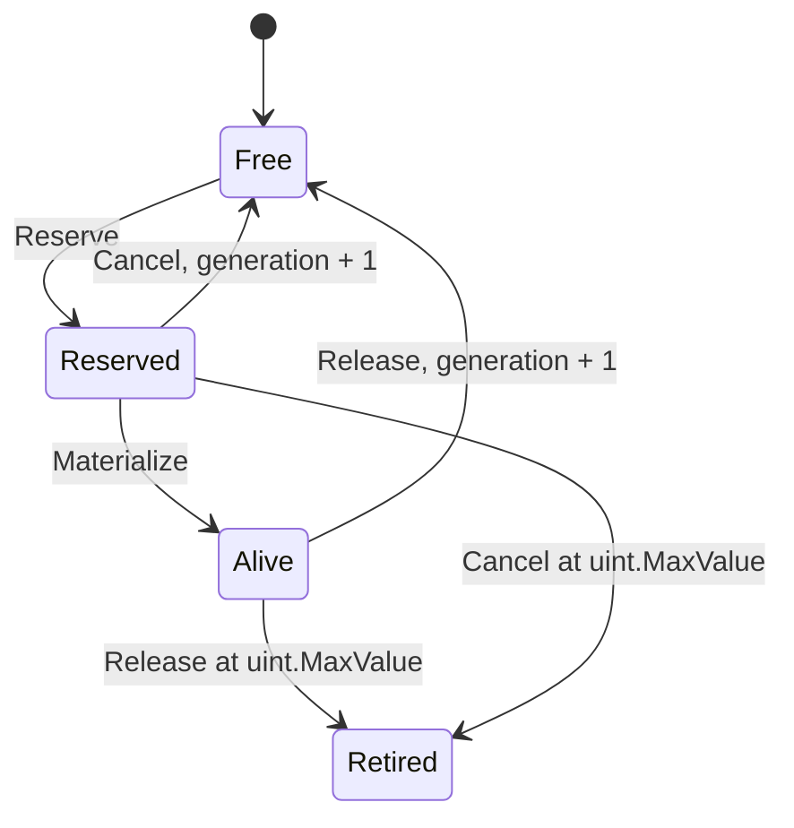
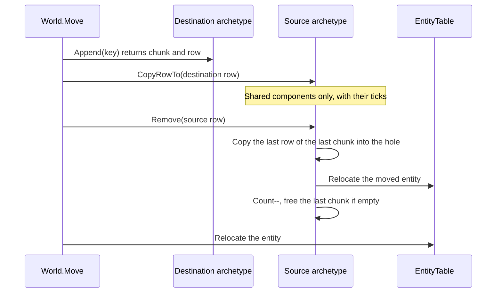

Archevolt stores components by archetype. An archetype is one sorted set of component IDs. It owns native, 64-byte-aligned chunks, and each chunk holds its components as structure-of-arrays columns. A paged entity table maps every handle to its current archetype, chunk, and row, so handles stay stable while rows move.

All allocation and migration happen on the owner thread, while the world is idle or at a command barrier. The only storage mutation that runs alongside systems is reserving an entity handle.

## Explore a world

The explorer runs a small model of the runtime. It follows the same steps as `Chunks.cs`, `Entity.cs`, and `World.cs`, and uses 384-byte chunks so a chunk fits on screen. Each operation records a trace. Step through it to see the state each step leaves behind and the member that produces it. Arrow keys step when the trace has focus.

<StorageExplorer />

Things to try:

- Select `e2` and despawn it. The hole is filled from the last row of the last chunk, so `e11` moves from chunk 1 into chunk 0.
- Despawn an entity, keep its handle selected, and spawn again. The slot comes back with a new generation, and the old handle fails `IsAlive`.
- Add `Health` to an entity. The row moves to a new archetype, and `Added` and `Changed` take the insert's tick.
- Run `Watch` twice. The second run sees nothing. Run `Regen`, then `Watch` again: the writable reference stamped `Changed`.
- Run `Spawner`. Its two slots stay `Reserved` until the barrier plays the commands.
- Spawn ten more movers, set MaxConcurrency to 3, and run `Movement` to see the chunk ranges each worker takes.

## Entities

An `Entity` is three fields: `WorldId` (`long`), `Index` (`int`), and `Generation` (`uint`). World IDs and generations both start at 1, so `default(Entity)` is the null handle. A chunk stores only the 8-byte `EntityKey` of index and generation. The world ID is added back when a row is read as an `Entity`.

`EntityTable` keeps one entry per slot, in pages of 1024. An entry holds the generation, the state, references to the archetype and chunk, and the row. Growth appends a page and publishes the page array with `Volatile.Write`. Existing pages never move, so reserving handles in parallel never invalidates an entry.

Freed slots go on a LIFO stack, so the most recently freed slot is reused first. A handle is alive only if its world ID matches, its index is below the number of issued slots, its generation matches the slot, and the slot is `Alive`. A despawned handle fails the generation check. A handle returned by `Commands.Spawn` fails the state check until playback.

## Archetypes

`ComponentRegistry` fixes world-local component IDs, in registration order, when the world is built. Each archetype is interned under its sorted IDs joined with commas, such as `"0,1"`. Archetypes are never removed, so an archetype's index stays valid for the life of the world and query caches only append.

Each archetype caches its add and remove edges. A cache miss derives the new ID set and looks it up. Membership tests use a `ulong` bitset with as many words as the registry needs, so there is no 64-component limit. A component's column is its position in the archetype's sorted IDs.

Bundle archetypes are created when the world is built. The empty archetype is created by the first `Spawn()`.

## Chunk layout

`ChunkLayout` computes one layout per archetype:

1. `rowBytes` is 8 bytes for the `EntityKey`, plus each component's size, plus 16 bytes for each tracked component's `Added` and `Changed` ticks.
2. The first capacity is `max(1, target / rowBytes)`. The target is `WithChunkBytes`, 16 KiB by default.
3. Columns follow component-ID order: the entity column, then each component's values, `Added`, and `Changed` columns. Every column starts on a 64-byte boundary. A tag has no value column.
4. While the total exceeds the target and capacity is above 1, capacity drops by one and the columns are placed again.

A chunk has no header. Its row count lives on the managed `NativeChunk`. `ChunkPool` allocates blocks with `NativeMemory.AlignedAlloc(bytes, 64)`, keeps up to 64 free blocks for each exact size, and zero-fills every block it hands out.

<ChunkLayoutLab />

:::warning
Every column costs at least 64 bytes. A small `WithChunkBytes` value with several columns drops capacity to one row, and the chunk can then be larger than the target.
:::

## Structural changes

A spawn appends a row to the bundle's archetype. `Append` uses the last chunk if it has room, and otherwise creates one. Inserting or removing a component moves the row with `World.Move`:

Ticks travel with the row, so a move is never a change. An inserted component gets both `Added` and `Changed`. A replaced component gets `Changed` only, even when the value is equal. Despawn records removals, swap-removes the row, and releases the slot.

Removal always takes its filler from the archetype's last row. Every chunk but the last is full, and an emptied chunk returns to the pool at once. Row order is therefore not stable. Bytes past the row count are not cleared, because every append writes every column.

## Ticks and queries

The world has one `ulong` clock. Every idle mutation that takes effect, every system `Begin`, and every barrier draws a tick. A system observes stamps in `(LastRun, ThisRun]`, and `LastRun` advances only after a successful run. A system never sees its own writes on its next run, because they carry its `ThisRun`.

`QueryState.Refresh` scans only the archetypes created since its last refresh. It runs on the owner thread when a schedule starts and after every barrier, so no archetype can appear during a batch. The query cursor numbers matched chunks in order. Partition `p` of `P` takes chunk ordinals `[chunks × p / P, chunks × (p + 1) / P)`. The split counts chunks, not rows.

Column access checks the declared type key, the access mode, and the tracking policy. Spans are always as long as the chunk's row count. A writable tracked column is reachable only through `TrackedColumn`, which stamps `Changed` before it returns a reference.

## Commands and barriers

`Commands.Spawn` writes its payload into the system's private buffer and reserves the handle immediately, under the table lock. The reserved entity stays out of queries. At a barrier, after the workers join, `FlushCommands` plays producers in plan order and each producer's records in recording order, all under one tick. Playback uses the same functions as the idle API.

If a record fails, earlier effects remain, the remaining reservations are cancelled, and `CommandPlaybackException` reports the producer and record index.

## Disposal

`World.Dispose` requires an idle world with no bound schedules. It joins the worker threads first, then returns every chunk and frees every block the pool owns. `NativeChunk` has no finalizer, so native memory is released only by `Dispose`.

## Source map

| File | Contents |
| --- | --- |
| `src/Archevolt/Entities/Entity.cs` | `Entity`, `EntityKey`, `EntityTable` |
| `src/Archevolt/Storage/Descriptors.cs` | `TypeKey<T>`, `ComponentDescriptor`, `BundleWriter`, `ComponentRegistry` |
| `src/Archevolt/Storage/Chunks.cs` | `ChunkPool`, `ChunkLayout`, `NativeChunk`, `Archetype` |
| `src/Archevolt/World.cs` | Interning, transitions, `Move`, `Stamp`, the idle API, `Dispose` |
| `src/Archevolt/Commands/Commands.cs` | Command buffers, playback, `WriteBundle` |
| `src/Archevolt/Queries/QueryState.cs` | `Refresh`, `QueryCursor`, `ChunkView`, `TrackedColumn` |
| `src/Archevolt/Execution/BoundSchedule.cs` | Tick assignment, partitioning, barriers |
