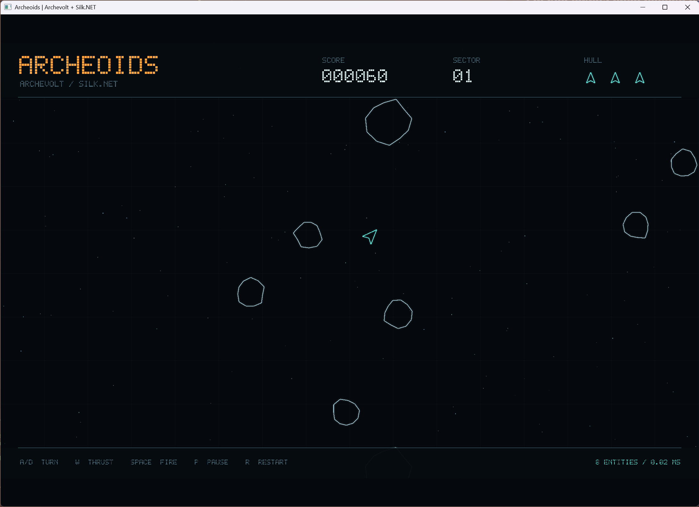

Archeoids is a small Asteroids game built with Archevolt and [Silk.NET](https://dotnet.github.io/Silk.NET/). Fly through wrapping sectors, split rocks, and survive with three lives. Archevolt runs the gameplay, and Silk.NET handles the window, input, and rendering. All shapes and text are generated in code.

## Run

From the repository root:

```powershell
dotnet run --project samples/Archeoids -c Release
```

The desktop game needs a graphical session and an OpenGL 3.3 driver. NuGet restores Silk.NET's windowing, input, OpenGL bindings, and native GLFW dependencies.

| Key | Action |
| --- | --- |
| A / D or Left / Right | Turn |
| W or Up | Thrust |
| Space | Fire |
| P | Pause or resume |
| R | Restart |
| Escape | Quit |

The HUD shows score, sector, remaining lives, visible entity count, and smoothed simulation time per tick. A new ship flashes during its temporary invulnerability. Clear every rock to start the next sector.

## Read the code

| File | Role |
| --- | --- |
| [GameModel.cs](https://github.com/Stephanvs/archevolt/blob/main/samples/Archeoids/GameModel.cs) | Unmanaged components, spawn bundles, resources, messages, and the wrapping arena. |
| [GameSystems.cs](https://github.com/Stephanvs/archevolt/blob/main/samples/Archeoids/GameSystems.cs) | Generated queries, systems, and explicit schedule dependencies. |
| [Game.cs](https://github.com/Stephanvs/archevolt/blob/main/samples/Archeoids/Game.cs) | Owns the world and schedules. `Step` advances one fixed 1/120-second tick, and `Capture` extracts sprites after commands flush. |
| [Program.cs](https://github.com/Stephanvs/archevolt/blob/main/samples/Archeoids/Program.cs) | Connects the window and keyboard to the fixed-step loop. |
| [VectorRenderer.cs](https://github.com/Stephanvs/archevolt/blob/main/samples/Archeoids/VectorRenderer.cs) | Batches procedural shapes and a tiny bitmap font into OpenGL triangles. It never accesses the world. |
| [Verification.cs](https://github.com/Stephanvs/archevolt/blob/main/samples/Archeoids/Verification.cs) | Exercises the real simulation and captures the framebuffer during a smoke run. |

## Patterns to look for

- **Deferred commands.** A hit marks its rock immediately, then queues despawns, so overlapping bullets cannot destroy it twice. See [Deferred commands](/guides/commands).
- **Independent message readers.** Three readers consume `RockDestroyed` to split rocks, award points, and create particles. See [Messages](/guides/messages).
- **Tags that change membership.** Adding and removing `Invulnerable` changes whether a ship matches the damage query. See [Queries and filters](/guides/queries).
- **Deterministic simulation.** A seeded random resource and a fixed timestep make runs reproducible. Restart replaces the world and its schedules, which clears entities and message cursors.

Collision detection uses simple bullet-versus-rock loops, because the sample is intended for a small arena.

## Verify

Run deterministic gameplay checks without a window:

```powershell
dotnet run --project samples/Archeoids -c Release -- --verify
```

The checks cover one-hit rock splitting, independent message readers, command visibility, expiration before collision, wrapping, seam collisions, invulnerability, game over, waves, and restart. Success prints `archeoids=ok checks=5`.

Run six seconds of scripted play through the real window and renderer:

```powershell
dotnet run --project samples/Archeoids -c Release -- --smoke-test
```

The smoke run checks that the framebuffer contains foreground geometry, writes `artifacts/archeoids/smoke.bmp`, prints `graphics=ok`, and closes automatically. It needs a graphical session, while the gameplay checks can run in headless CI.
