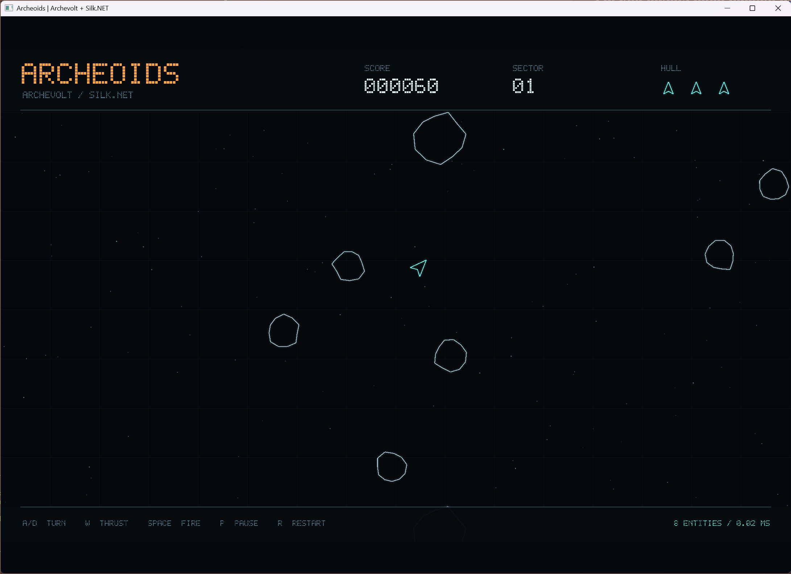

# Archeoids

A small Asteroids game built with Archevolt. Fly through wrapping sectors, collect weapon upgrades, and survive with three lives as the sectors get denser. Ships, rocks, bullets, pickups, and particles are ECS entities. The desktop host uses [Silk.NET](https://dotnet.github.io/Silk.NET/) and OpenGL. The browser host uses plain .NET WebAssembly and WebGPU, with browser-rendered text.



## Run on desktop

From the repository root:

```powershell
dotnet run --project samples/Archeoids -c Release
```

Use the latest .NET 11 SDK. The desktop game needs a graphical session and an OpenGL 3.3 driver. NuGet restores Silk.NET's windowing, input, OpenGL bindings, and native GLFW dependencies. This project opts out of the other samples' NativeAOT publishing default.

| Key | Action |
| --- | --- |
| A / D or Left / Right | Turn |
| W or Up | Thrust |
| Space | Fire |
| P | Pause or resume |
| R | Restart |
| Escape | Quit |

The HUD shows your weapon, score, sector, remaining lives, FPS, visible entity count, and smoothed simulation time per tick. FPS measures rendered frames over at least half a second and continues updating while gameplay is paused. A new ship flashes during its temporary invulnerability. Clear every rock to start the next sector.

Large rocks drop a green diamond when no pickup is already present. Fly near it to draw it toward your ship, then catch it within 18 seconds. Each pickup recharges your shield for 2.5 seconds and advances your weapon through single, twin, rapid twin, quad, and overdrive. Overdrive fires four slightly spread shots every 0.05 seconds. You keep upgrades when you lose a life; restarting resets them.

The first sector has four large rocks. Each later sector adds four, up to forty in sector ten. Rock speed also increases, then stops increasing after sector ten. New rocks spawn at least 260 units from your current position, including across screen seams, and cleared sectors give you a 2.2-second break. Later explosions create more, longer-lived debris. Dense combat can exceed 800 concurrent entities, including bullets and particles. Explosion effects share a budget of 1,600 particles so bursts stay bounded.

## Run in a browser

From the repository root:

```powershell
dotnet run --project samples/Archeoids.Browser
```

Open the HTTP localhost URL printed by the development host. Use a browser with WebGPU enabled and a compatible graphics adapter. WebGPU requires HTTPS or localhost. If WebGPU or the adapter is unavailable, the page displays an error.

The development host runs interpreted .NET, including when started with `-c Release`. Use a Release publish to measure browser game performance. The default Debug configuration restores its managed runtime packs through NuGet and needs no separate workload, JavaScript packages, or bundler.

The browser project uses `Microsoft.NET.Sdk.WebAssembly` with `browser-wasm`. Release publishing enables [WebAssembly AOT compilation](https://github.com/dotnet/runtime/blob/main/src/mono/wasm/features.md) through `RunAOTCompilation`. Debug disables AOT. Browser threads remain disabled. The project also disables the samples' inherited `PublishAot`, which controls desktop NativeAOT and is a different setting.

## Publish the browser game

Install the WebAssembly build tools for the selected .NET 11 SDK, then publish:

```powershell
dotnet workload install wasm-tools
dotnet publish samples/Archeoids.Browser -c Release -o artifacts/archeoids-browser
```

Serve the published `wwwroot` directory over localhost. For example, with Python 3 installed:

```powershell
python -m http.server 8000 --bind 127.0.0.1 --directory artifacts/archeoids-browser/wwwroot
```

Open `http://127.0.0.1:8000`. Measure FPS and simulation tick time in this published build on your target hardware, including the denser later sectors. AOT uses the same C# simulation and renderer without reducing entity density.

## Read the sample

- [GameModel.cs](GameModel.cs) defines unmanaged components, spawn bundles, weapon tiers, resources, messages, and the wrapping arena.
- [GameSystems.cs](GameSystems.cs) contains generated queries, systems, and explicit schedule dependencies. Movement uses partitionable `[Each]`; this small sample runs serially.
- [Game.cs](Game.cs) owns the world and schedules. `Step` advances one fixed 1/120-second tick. `Capture` extracts a reusable list of sprites after simulation commands flush.
- [Program.cs](Program.cs) connects Silk.NET's window and keyboard to the fixed-step loop.
- [FrameGeometry.cs](FrameGeometry.cs) builds the reusable coloured triangle batch: stars, sprites, translucent effects, HUD panels, hull icons, and pause/game-over shading. It reads the extracted frame and never accesses the world.
- [VectorRenderer.cs](VectorRenderer.cs) uploads that batch to OpenGL and appends the desktop bitmap text.
- [Archeoids.Browser.csproj](../Archeoids.Browser/Archeoids.Browser.csproj) links the same `Game.cs`, `GameModel.cs`, `GameSystems.cs`, and `FrameGeometry.cs` source files. There is one simulation implementation. Silk.NET and desktop verification stay outside the browser dependency graph.
- The browser [Program.cs](../Archeoids.Browser/Program.cs) receives animation frames through `[JSExport]`, runs the fixed-step accumulator, and sends a `Span<byte>` through `[JSImport]`. The [page host](../Archeoids.Browser/wwwroot/main.js) owns keyboard and focus events. The [renderer](../Archeoids.Browser/wwwroot/renderer.js) copies the active binary batch into reusable staging storage and uploads it to a reusable vertex buffer. One WGSL pipeline draws the triangles with alpha blending, followed by the Canvas 2D HUD. There is one call into C# and one render call back to JavaScript per frame.
- [Verification.cs](Verification.cs) exercises the real simulation and captures the OpenGL framebuffer during a smoke run.

Structural changes use `Commands`. A hit marks its rock immediately before queuing despawns, preventing overlapping bullets from destroying it twice. Four independent readers consume `RockDestroyed` to split rocks, award points, drop upgrades, and create particles. Adding and removing `Invulnerable` changes whether a ship matches the damage query. Expiration runs before collision detection, and both collisions and drawing handle screen seams.

The simulation uses a seeded random resource and a fixed timestep. Both hosts cap incoming elapsed time at 100 ms and advance at 120 ticks per second. Restart replaces the world and its schedules, clearing entities and message cursors. The playfield has its own area below the HUD, and resizing preserves its aspect ratio. Collision detection uses simple bullet-versus-rock loops; this sample is intended for a small arena.

## Verify

Run deterministic gameplay checks without a window:

```powershell
dotnet run --project samples/Archeoids -c Release -- --verify
```

The checks cover one-hit rock splitting, independent message readers, command visibility, expiration before collision, wrapping, seam collisions, invulnerability, game over, waves, restart, FPS sampling, collectible upgrades, all weapon tiers, safe sector spawning, and bounded density. A seeded 30-second late-sector combat run checks for at least 800 concurrent entities and prints its peak counts. Success prints `archeoids=ok checks=9`. The repository's `scripts/verify.ps1` includes these headless checks.

Run six seconds of scripted play through the real window and renderer:

```powershell
dotnet run --project samples/Archeoids -c Release -- --smoke-test
```

The smoke run checks that the framebuffer contains foreground geometry, writes `artifacts/archeoids/smoke.bmp` relative to the working directory, prints `graphics=ok`, and closes automatically. It requires a graphical session. Gameplay checks can run in headless CI.
